# Graph Report - axum

## Corpus Check
- **Nodes:** 7400 · **Edges:** 13869 · **Communities:** 620
- **Extraction Engine:** 100% Native Tree-Sitter AST & Justfile Integration

## God Nodes (Most connected abstractions)
1. `Router::new()` [function] - 394 connections (axum/benches/benches.rs:L26)
2. `get()` [function] - 304 connections (axum/benches/benches.rs:L26)
3. `Ok()` [function] - 249 connections (axum/src/error_handling/mod.rs:L131)
4. `TestClient::new()` [function] - 240 connections (axum/src/extension.rs:L228)
5. `Router::new().route()` [function] - 216 connections (axum/benches/benches.rs:L26)
6. `client.get()` [function] - 171 connections (axum/src/extension.rs:L230)
7. `axum` [import] - 154 connections (axum/benches/benches.rs:L3-L7)
8. `std` [import] - 128 connections (axum/benches/benches.rs:L9-L13)
9. `Some()` [function] - 122 connections (axum/src/extract/matched_path.rs:L129)
10. `mod.rs` [file] - 98 connections (axum/src/routing/tests/mod.rs:L1)
11. `axum_macros` [import] - 95 connections (axum/src/extract/mod.rs:L27)
12. `Err()` [function] - 93 connections (axum/src/extract/connect_info.rs:L150)

## Key Structural Connections
- `benches.rs` --[defines]--> `main` (Extracted)
- `benches.rs` --[defines]--> `AppState` (Extracted)
- `benches.rs` --[defines]--> `Payload` (Extracted)
- `benches.rs` --[defines]--> `benchmark` (Extracted)
- `benches.rs` --[defines]--> `BenchmarkBuilder` (Extracted)
- `benches.rs` --[defines]--> `run` (Extracted)
- `benches.rs` --[defines]--> `install_rewrk` (Extracted)
- `benches.rs` --[defines]--> `ensure_rewrk_is_installed` (Extracted)
- `benches.rs` --[defines]--> `on_ci` (Extracted)
- `benches.rs` --[imports]--> `axum` (Extracted)
- `benches.rs` --[imports]--> `serde` (Extracted)
- `benches.rs` --[imports]--> `std` (Extracted)
- `main` --[calls]--> `on_ci` (Inferred)
- `main` --[calls]--> `install_rewrk` (Inferred)
- `main` --[calls]--> `ensure_rewrk_is_installed` (Inferred)
- `main` --[calls]--> `benchmark("minimal").run()` (Inferred)
- `main` --[calls]--> `benchmark` (Inferred)
- `main` --[calls]--> `benchmark("basic")
        .path("/a/b/c")
        .run()` (Inferred)
- `main` --[calls]--> `benchmark("basic")
        .path()` (Inferred)
- `main` --[calls]--> `Router::new().route()` (Inferred)

## Architecture Diagram (Mermaid Preview)

```mermaid
flowchart TD
    file_axum_benches_benches_rs["benches.rs"]
    function_axum_benches_benches_rs_main["main"]
    struct_axum_benches_benches_rs_AppState["AppState"]
    struct_axum_benches_benches_rs_Payload["Payload"]
    function_axum_benches_benches_rs_benchmark["benchmark"]
    struct_axum_benches_benches_rs_BenchmarkBuilder["BenchmarkBuilder"]
    method_axum_benches_benches_rs_run["run"]
    function_axum_benches_benches_rs_install_rewrk["install_rewrk"]
    function_axum_benches_benches_rs_ensure_rewrk_is_installed["ensure_rewrk_is_installed"]
    function_axum_benches_benches_rs_on_ci["on_ci"]
    mod_axum["axum"]
    mod_serde["serde"]
    mod_std["std"]
    fn_benchmark__minimal___run["benchmarkminimal.run"]
    fn_benchmark__basic____________path___a_b_c____________run["benchmarkbasic
        .path/a/b/c
        .run"]
    fn_benchmark__basic____________path["benchmarkbasic
        .path"]
    fn_Router__new___route["Router::new.route"]
    fn_Router__new["Router::new"]
    fn_get["get"]
    fn_benchmark__basic_merge___path___a_b_c___run["benchmarkbasic-merge.path/a/b/c.run"]
    fn_benchmark__basic_merge___path["benchmarkbasic-merge.path"]
    fn_Router__new___merge["Router::new.merge"]
    fn_benchmark__basic_nest___path___a_b_c___run["benchmarkbasic-nest.path/a/b/c.run"]
    fn_benchmark__basic_nest___path["benchmarkbasic-nest.path"]
    fn_Router__new___nest["Router::new.nest"]
    fn_benchmark__routing___path___foo_bar_baz___run["benchmarkrouting.path/foo/bar/baz.run"]
    fn_benchmark__routing___path["benchmarkrouting.path"]
    fn_app_route["app.route"]
    fn_benchmark__receive_json____________method__post____________headers_____content_type____application_json______________body_r____n___123___s____hi_there____b___false______________run["benchmarkreceive-json
        .methodpost
        .headers&[content-type, application/json]
        .bodyr#{n: 123, s: hi there, b: false}#
        .run"]
    fn_benchmark__receive_json____________method__post____________headers_____content_type____application_json______________body["benchmarkreceive-json
        .methodpost
        .headers&[content-type, application/json]
        .body"]
    fn_benchmark__receive_json____________method__post____________headers["benchmarkreceive-json
        .methodpost
        .headers"]
    fn_benchmark__receive_json____________method["benchmarkreceive-json
        .method"]
    fn_post["post"]
    fn_benchmark__send_json___run["benchmarksend-json.run"]
    fn_Json["Json"]
    file_axum_benches_benches_rs -->|defines| function_axum_benches_benches_rs_main
    file_axum_benches_benches_rs -->|defines| struct_axum_benches_benches_rs_AppState
    file_axum_benches_benches_rs -->|defines| struct_axum_benches_benches_rs_Payload
    file_axum_benches_benches_rs -->|defines| function_axum_benches_benches_rs_benchmark
    file_axum_benches_benches_rs -->|defines| struct_axum_benches_benches_rs_BenchmarkBuilder
    file_axum_benches_benches_rs -->|defines| method_axum_benches_benches_rs_run
    file_axum_benches_benches_rs -->|defines| function_axum_benches_benches_rs_install_rewrk
    file_axum_benches_benches_rs -->|defines| function_axum_benches_benches_rs_ensure_rewrk_is_installed
    file_axum_benches_benches_rs -->|defines| function_axum_benches_benches_rs_on_ci
    file_axum_benches_benches_rs -->|imports| mod_axum
    file_axum_benches_benches_rs -->|imports| mod_serde
    file_axum_benches_benches_rs -->|imports| mod_std
    function_axum_benches_benches_rs_main -->|calls| function_axum_benches_benches_rs_on_ci
    function_axum_benches_benches_rs_main -->|calls| function_axum_benches_benches_rs_install_rewrk
    function_axum_benches_benches_rs_main -->|calls| function_axum_benches_benches_rs_ensure_rewrk_is_installed
    function_axum_benches_benches_rs_main -->|calls| fn_benchmark__minimal___run
    function_axum_benches_benches_rs_main -->|calls| function_axum_benches_benches_rs_benchmark
    function_axum_benches_benches_rs_main -->|calls| fn_benchmark__basic____________path___a_b_c____________run
    function_axum_benches_benches_rs_main -->|calls| fn_benchmark__basic____________path
    function_axum_benches_benches_rs_main -->|calls| fn_Router__new___route
    function_axum_benches_benches_rs_main -->|calls| fn_Router__new
    function_axum_benches_benches_rs_main -->|calls| fn_get
    function_axum_benches_benches_rs_main -->|calls| fn_benchmark__basic_merge___path___a_b_c___run
    function_axum_benches_benches_rs_main -->|calls| fn_benchmark__basic_merge___path
    function_axum_benches_benches_rs_main -->|calls| fn_Router__new___merge
    function_axum_benches_benches_rs_main -->|calls| fn_benchmark__basic_nest___path___a_b_c___run
    function_axum_benches_benches_rs_main -->|calls| fn_benchmark__basic_nest___path
    function_axum_benches_benches_rs_main -->|calls| fn_Router__new___nest
    function_axum_benches_benches_rs_main -->|calls| fn_benchmark__routing___path___foo_bar_baz___run
    function_axum_benches_benches_rs_main -->|calls| fn_benchmark__routing___path
    function_axum_benches_benches_rs_main -->|calls| fn_app_route
    function_axum_benches_benches_rs_main -->|calls| fn_benchmark__receive_json____________method__post____________headers_____content_type____application_json______________body_r____n___123___s____hi_there____b___false______________run
    function_axum_benches_benches_rs_main -->|calls| fn_benchmark__receive_json____________method__post____________headers_____content_type____application_json______________body
    function_axum_benches_benches_rs_main -->|calls| fn_benchmark__receive_json____________method__post____________headers
    function_axum_benches_benches_rs_main -->|calls| fn_benchmark__receive_json____________method
    function_axum_benches_benches_rs_main -->|calls| fn_post
    function_axum_benches_benches_rs_main -->|calls| fn_benchmark__send_json___run
    function_axum_benches_benches_rs_main -->|calls| fn_Json
    method_axum_benches_benches_rs_run -->|calls| function_axum_benches_benches_rs_on_ci

```

