# Graph Report - tower-http

## Corpus Check
- **Nodes:** 4686 · **Edges:** 9993 · **Communities:** 199
- **Extraction Engine:** 100% Native Tree-Sitter AST & Justfile Integration

## God Nodes (Most connected abstractions)
1. `Body::empty()` [function] - 254 connections (examples/axum-key-value-store/src/main.rs:L131)
2. `Request::builder()` [function] - 189 connections (examples/custom-future-multiple-bodies/src/main.rs:L111)
3. `svc.oneshot()` [function] - 154 connections (tower-http/src/catch_panic.rs:L383)
4. `tests.rs` [file] - 132 connections (tower-http/src/services/fs/serve_dir/tests.rs:L1)
5. `Ok()` [function] - 113 connections (examples/axum-key-value-store/src/main.rs:L105)
6. `svc.oneshot(req).await.unwrap()` [function] - 113 connections (tower-http/src/catch_panic.rs:L383)
7. `std` [import] - 89 connections (examples/axum-key-value-store/src/main.rs:L10-L15)
8. `ServeDir::new()` [function] - 88 connections (tower-http/src/services/fs/serve_dir/tests.rs:L28)
9. `http` [import] - 87 connections (examples/custom-future-multiple-bodies/src/main.rs:L2)
10. `res.into_body()` [function] - 85 connections (tower-http/src/compression/mod.rs:L138)
11. `super` [import] - 79 connections (examples/axum-key-value-store/src/main.rs:L123)
12. `Some()` [function] - 78 connections (tower-http/src/auth/async_require_authorization.rs:L336)

## Key Structural Connections
- `main.rs` --[defines]--> `Config` (Extracted)
- `main.rs` --[defines]--> `AppState` (Extracted)
- `main.rs` --[defines]--> `main` (Extracted)
- `main.rs` --[defines]--> `app` (Extracted)
- `main.rs` --[defines]--> `get_key` (Extracted)
- `main.rs` --[defines]--> `set_key` (Extracted)
- `main.rs` --[defines]--> `tests` (Extracted)
- `main.rs` --[defines]--> `get_and_set_value` (Extracted)
- `main.rs` --[imports]--> `axum` (Extracted)
- `main.rs` --[imports]--> `clap` (Extracted)
- `main.rs` --[imports]--> `std` (Extracted)
- `main.rs` --[imports]--> `tokio` (Extracted)
- `main.rs` --[imports]--> `tower` (Extracted)
- `main.rs` --[imports]--> `tower_http` (Extracted)
- `main.rs` --[imports]--> `super` (Extracted)
- `main` --[calls]--> `tracing_subscriber::fmt::init()` (Inferred)
- `main` --[calls]--> `Config::parse()` (Inferred)
- `main` --[calls]--> `SocketAddr::from()` (Inferred)
- `main` --[calls]--> `axum::serve(
        TcpListener::bind(addr).await.expect("bind error"),
        app().into_make_service(),
    )
    .await
    .expect()` (Inferred)
- `main` --[calls]--> `axum::serve()` (Inferred)

## Architecture Diagram (Mermaid Preview)

```mermaid
flowchart TD
    file_Cargo_toml["Cargo.toml"]
    file_CONTRIBUTING_md["CONTRIBUTING.md"]
    file_deny_toml["deny.toml"]
    file_examples_axum_key_value_store_Cargo_toml["Cargo.toml"]
    file_examples_axum_key_value_store_README_md["README.md"]
    file_examples_axum_key_value_store_src_main_rs["main.rs"]
    struct_examples_axum_key_value_store_src_main_rs_Config["Config"]
    struct_examples_axum_key_value_store_src_main_rs_AppState["AppState"]
    function_examples_axum_key_value_store_src_main_rs_main["main"]
    function_examples_axum_key_value_store_src_main_rs_app["app"]
    function_examples_axum_key_value_store_src_main_rs_get_key["get_key"]
    function_examples_axum_key_value_store_src_main_rs_set_key["set_key"]
    module_examples_axum_key_value_store_src_main_rs_tests["tests"]
    method_examples_axum_key_value_store_src_main_rs_get_and_set_value["get_and_set_value"]
    mod_axum["axum"]
    mod_clap["clap"]
    mod_std["std"]
    mod_tokio["tokio"]
    mod_tower["tower"]
    mod_tower_http["tower_http"]
    mod_super["super"]
    fn_tracing_subscriber__fmt__init["tracing_subscriber::fmt::init"]
    fn_Config__parse["Config::parse"]
    fn_SocketAddr__from["SocketAddr::from"]
    fn_axum__serve__________TcpListener__bind_addr__await_expect__bind_error____________app___into_make_service_______________await______expect["axum::serve
        TcpListener::bindaddr.await.expectbind error,
        app.into_make_service,
    
    .await
    .expect"]
    fn_axum__serve["axum::serve"]
    fn_TcpListener__bind_addr__await_expect["TcpListener::bindaddr.await.expect"]
    fn_TcpListener__bind["TcpListener::bind"]
    fn_app___into_make_service["app.into_make_service"]
    fn_Arc__new["Arc::new"]
    fn_RwLock__new["RwLock::new"]
    fn_HashMap__new["HashMap::new"]
    fn_vec__header__AUTHORIZATION__header__COOKIE__into["vec![header::AUTHORIZATION, header::COOKIE].into"]
    fn_ServiceBuilder__new______________Mark_the__Authorization__and__Cookie__headers_as_sensitive_so_it_doesn_t_show_in_logs__________sensitive_request_headers_sensitive_headers_clone_______________Add_high_level_tracing_logging_to_all_requests__________layer______________TraceLayer__new_for_http____________________on_body_chunk__chunk___Bytes__latency__Duration______tracing__Span________________________tracing__trace__size_bytes___chunk_len____latency____latency___sending_body_chunk_______________________________________make_span_with_DefaultMakeSpan__new___include_headers_true____________________on_response_DefaultOnResponse__new___include_headers_true__latency_unit_LatencyUnit__Micros_________________________Report_clients_that_disconnect_before_the_response_completes_____________Fires_inside_the_TraceLayer_span_so_events_carry_the_request_context___________layer_OnEarlyDropLayer__new_EarlyDropsAsFailures__new______________DefaultOnFailure__default_________________________sensitive_response_headers_sensitive_headers_____________Set_a_timeout__________layer_TimeoutLayer__with_status_code_StatusCode__REQUEST_TIMEOUT__Duration__from_secs_10_______________Compress_responses__________compression______________Set_a__Content_Type__if_there_isn_t_one_already___________insert_response_header_if_not_present["ServiceBuilder::new
        // Mark the `Authorization` and `Cookie` headers as sensitive so it doesn't show in logs
        .sensitive_request_headerssensitive_headers.clone
        // Add high level tracing/logging to all requests
        .layer
            TraceLayer::new_for_http
                .on_body_chunk|chunk: &Bytes, latency: Duration, _: &tracing::Span| {
                    tracing::trace!size_bytes = chunk.len, latency = ?latency, sending body chunk
                }
                .make_span_withDefaultMakeSpan::new.include_headerstrue
                .on_responseDefaultOnResponse::new.include_headerstrue.latency_unitLatencyUnit::Micros,
        
        // Report clients that disconnect before the response completes.
        // Fires inside the TraceLayer span so events carry the request context.
        .layerOnEarlyDropLayer::newEarlyDropsAsFailures::new
            DefaultOnFailure::default,
        
        .sensitive_response_headerssensitive_headers
        // Set a timeout
        .layerTimeoutLayer::with_status_codeStatusCode::REQUEST_TIMEOUT, Duration::from_secs10
        // Compress responses
        .compression
        // Set a `Content-Type` if there isn't one already.
        .insert_response_header_if_not_present"]
    fn_ServiceBuilder__new______________Mark_the__Authorization__and__Cookie__headers_as_sensitive_so_it_doesn_t_show_in_logs__________sensitive_request_headers_sensitive_headers_clone_______________Add_high_level_tracing_logging_to_all_requests__________layer______________TraceLayer__new_for_http____________________on_body_chunk__chunk___Bytes__latency__Duration______tracing__Span________________________tracing__trace__size_bytes___chunk_len____latency____latency___sending_body_chunk_______________________________________make_span_with_DefaultMakeSpan__new___include_headers_true____________________on_response_DefaultOnResponse__new___include_headers_true__latency_unit_LatencyUnit__Micros_________________________Report_clients_that_disconnect_before_the_response_completes_____________Fires_inside_the_TraceLayer_span_so_events_carry_the_request_context___________layer_OnEarlyDropLayer__new_EarlyDropsAsFailures__new______________DefaultOnFailure__default_________________________sensitive_response_headers_sensitive_headers_____________Set_a_timeout__________layer_TimeoutLayer__with_status_code_StatusCode__REQUEST_TIMEOUT__Duration__from_secs_10_______________Compress_responses__________compression["ServiceBuilder::new
        // Mark the `Authorization` and `Cookie` headers as sensitive so it doesn't show in logs
        .sensitive_request_headerssensitive_headers.clone
        // Add high level tracing/logging to all requests
        .layer
            TraceLayer::new_for_http
                .on_body_chunk|chunk: &Bytes, latency: Duration, _: &tracing::Span| {
                    tracing::trace!size_bytes = chunk.len, latency = ?latency, sending body chunk
                }
                .make_span_withDefaultMakeSpan::new.include_headerstrue
                .on_responseDefaultOnResponse::new.include_headerstrue.latency_unitLatencyUnit::Micros,
        
        // Report clients that disconnect before the response completes.
        // Fires inside the TraceLayer span so events carry the request context.
        .layerOnEarlyDropLayer::newEarlyDropsAsFailures::new
            DefaultOnFailure::default,
        
        .sensitive_response_headerssensitive_headers
        // Set a timeout
        .layerTimeoutLayer::with_status_codeStatusCode::REQUEST_TIMEOUT, Duration::from_secs10
        // Compress responses
        .compression"]
    file_examples_axum_key_value_store_src_main_rs -->|defines| struct_examples_axum_key_value_store_src_main_rs_Config
    file_examples_axum_key_value_store_src_main_rs -->|defines| struct_examples_axum_key_value_store_src_main_rs_AppState
    file_examples_axum_key_value_store_src_main_rs -->|defines| function_examples_axum_key_value_store_src_main_rs_main
    file_examples_axum_key_value_store_src_main_rs -->|defines| function_examples_axum_key_value_store_src_main_rs_app
    file_examples_axum_key_value_store_src_main_rs -->|defines| function_examples_axum_key_value_store_src_main_rs_get_key
    file_examples_axum_key_value_store_src_main_rs -->|defines| function_examples_axum_key_value_store_src_main_rs_set_key
    file_examples_axum_key_value_store_src_main_rs -->|defines| module_examples_axum_key_value_store_src_main_rs_tests
    file_examples_axum_key_value_store_src_main_rs -->|defines| method_examples_axum_key_value_store_src_main_rs_get_and_set_value
    file_examples_axum_key_value_store_src_main_rs -->|imports| mod_axum
    file_examples_axum_key_value_store_src_main_rs -->|imports| mod_clap
    file_examples_axum_key_value_store_src_main_rs -->|imports| mod_std
    file_examples_axum_key_value_store_src_main_rs -->|imports| mod_tokio
    file_examples_axum_key_value_store_src_main_rs -->|imports| mod_tower
    file_examples_axum_key_value_store_src_main_rs -->|imports| mod_tower_http
    file_examples_axum_key_value_store_src_main_rs -->|imports| mod_super
    function_examples_axum_key_value_store_src_main_rs_main -->|calls| fn_tracing_subscriber__fmt__init
    function_examples_axum_key_value_store_src_main_rs_main -->|calls| fn_Config__parse
    function_examples_axum_key_value_store_src_main_rs_main -->|calls| fn_SocketAddr__from
    function_examples_axum_key_value_store_src_main_rs_main -->|calls| fn_axum__serve__________TcpListener__bind_addr__await_expect__bind_error____________app___into_make_service_______________await______expect
    function_examples_axum_key_value_store_src_main_rs_main -->|calls| fn_axum__serve
    function_examples_axum_key_value_store_src_main_rs_main -->|calls| fn_TcpListener__bind_addr__await_expect
    function_examples_axum_key_value_store_src_main_rs_main -->|calls| fn_TcpListener__bind
    function_examples_axum_key_value_store_src_main_rs_main -->|calls| fn_app___into_make_service
    function_examples_axum_key_value_store_src_main_rs_main -->|calls| function_examples_axum_key_value_store_src_main_rs_app
    function_examples_axum_key_value_store_src_main_rs_app -->|calls| fn_Arc__new
    function_examples_axum_key_value_store_src_main_rs_app -->|calls| fn_RwLock__new
    function_examples_axum_key_value_store_src_main_rs_app -->|calls| fn_HashMap__new
    function_examples_axum_key_value_store_src_main_rs_app -->|calls| fn_vec__header__AUTHORIZATION__header__COOKIE__into
    function_examples_axum_key_value_store_src_main_rs_app -->|calls| fn_ServiceBuilder__new______________Mark_the__Authorization__and__Cookie__headers_as_sensitive_so_it_doesn_t_show_in_logs__________sensitive_request_headers_sensitive_headers_clone_______________Add_high_level_tracing_logging_to_all_requests__________layer______________TraceLayer__new_for_http____________________on_body_chunk__chunk___Bytes__latency__Duration______tracing__Span________________________tracing__trace__size_bytes___chunk_len____latency____latency___sending_body_chunk_______________________________________make_span_with_DefaultMakeSpan__new___include_headers_true____________________on_response_DefaultOnResponse__new___include_headers_true__latency_unit_LatencyUnit__Micros_________________________Report_clients_that_disconnect_before_the_response_completes_____________Fires_inside_the_TraceLayer_span_so_events_carry_the_request_context___________layer_OnEarlyDropLayer__new_EarlyDropsAsFailures__new______________DefaultOnFailure__default_________________________sensitive_response_headers_sensitive_headers_____________Set_a_timeout__________layer_TimeoutLayer__with_status_code_StatusCode__REQUEST_TIMEOUT__Duration__from_secs_10_______________Compress_responses__________compression______________Set_a__Content_Type__if_there_isn_t_one_already___________insert_response_header_if_not_present
    function_examples_axum_key_value_store_src_main_rs_app -->|calls| fn_ServiceBuilder__new______________Mark_the__Authorization__and__Cookie__headers_as_sensitive_so_it_doesn_t_show_in_logs__________sensitive_request_headers_sensitive_headers_clone_______________Add_high_level_tracing_logging_to_all_requests__________layer______________TraceLayer__new_for_http____________________on_body_chunk__chunk___Bytes__latency__Duration______tracing__Span________________________tracing__trace__size_bytes___chunk_len____latency____latency___sending_body_chunk_______________________________________make_span_with_DefaultMakeSpan__new___include_headers_true____________________on_response_DefaultOnResponse__new___include_headers_true__latency_unit_LatencyUnit__Micros_________________________Report_clients_that_disconnect_before_the_response_completes_____________Fires_inside_the_TraceLayer_span_so_events_carry_the_request_context___________layer_OnEarlyDropLayer__new_EarlyDropsAsFailures__new______________DefaultOnFailure__default_________________________sensitive_response_headers_sensitive_headers_____________Set_a_timeout__________layer_TimeoutLayer__with_status_code_StatusCode__REQUEST_TIMEOUT__Duration__from_secs_10_______________Compress_responses__________compression
    method_examples_axum_key_value_store_src_main_rs_get_and_set_value -->|calls| function_examples_axum_key_value_store_src_main_rs_app

```

