# Graph Report - tower

## Corpus Check
- **Nodes:** 2099 · **Edges:** 3357 · **Communities:** 188
- **Extraction Engine:** 100% Native Tree-Sitter AST & Justfile Integration

## God Nodes (Most connected abstractions)
1. `std` [import] - 97 connections (tower/examples/tower-balance.rs:L7)
2. `tower_service` [import] - 62 connections (tower/examples/tower-balance.rs:L19)
3. `support::trace_init()` [function] - 56 connections (tower/tests/balance/main.rs:L38)
4. `Ok()` [function] - 53 connections (tower/examples/tower-balance.rs:L100)
5. `super` [import] - 44 connections (tower/src/balance/p2c/layer.rs:L1)
6. `mod.rs` [file] - 43 connections (tower/src/util/mod.rs:L1)
7. `Poll::Ready()` [function] - 43 connections (tower/examples/tower-balance.rs:L100)
8. `stress` [function] - 43 connections (tower/tests/balance/main.rs:L37-L171)
9. `task::spawn()` [function] - 41 connections (tower/src/balance/p2c/test.rs:L37)
10. `cache.rs` [file] - 36 connections (tower/src/ready_cache/cache.rs:L1)
11. `mod.rs` [file] - 34 connections (tower/src/builder/mod.rs:L1)
12. `Some()` [function] - 34 connections (tower/examples/tower-balance.rs:L100)

## Key Structural Connections
- `tower-balance.rs` --[defines]--> `Summary` (Extracted)
- `tower-balance.rs` --[defines]--> `main` (Extracted)
- `tower-balance.rs` --[defines]--> `new` (Extracted)
- `tower-balance.rs` --[defines]--> `poll_next` (Extracted)
- `tower-balance.rs` --[defines]--> `gen_disco` (Extracted)
- `tower-balance.rs` --[defines]--> `run` (Extracted)
- `tower-balance.rs` --[defines]--> `compute_histo` (Extracted)
- `tower-balance.rs` --[defines]--> `count` (Extracted)
- `tower-balance.rs` --[defines]--> `report` (Extracted)
- `tower-balance.rs` --[defines]--> `Req` (Extracted)
- `tower-balance.rs` --[defines]--> `Rsp` (Extracted)
- `tower-balance.rs` --[imports]--> `futures_core` (Extracted)
- `tower-balance.rs` --[imports]--> `futures_util` (Extracted)
- `tower-balance.rs` --[imports]--> `hdrhistogram` (Extracted)
- `tower-balance.rs` --[imports]--> `pin_project_lite` (Extracted)
- `tower-balance.rs` --[imports]--> `std` (Extracted)
- `tower-balance.rs` --[imports]--> `tokio` (Extracted)
- `tower-balance.rs` --[imports]--> `tower` (Extracted)
- `tower-balance.rs` --[imports]--> `tower_service` (Extracted)
- `tower-balance.rs` --[calls]--> `Duration::from_millis()` (Inferred)

## Architecture Diagram (Mermaid Preview)

```mermaid
flowchart TD
    file_Cargo_toml["Cargo.toml"]
    file_deny_toml["deny.toml"]
    file_examples_Cargo_toml["Cargo.toml"]
    file_guides_building_a_middleware_from_scratch_md["building-a-middleware-from-scratch.md"]
    file_guides_README_md["README.md"]
    file_LICENSE["LICENSE"]
    file_netlify_toml["netlify.toml"]
    file_README_md["README.md"]
    file_tower_Cargo_toml["Cargo.toml"]
    file_tower_CHANGELOG_md["CHANGELOG.md"]
    file_tower_examples_tower_balance_rs["tower-balance.rs"]
    struct_tower_examples_tower_balance_rs_Summary["Summary"]
    function_tower_examples_tower_balance_rs_main["main"]
    method_tower_examples_tower_balance_rs_new["new"]
    method_tower_examples_tower_balance_rs_poll_next["poll_next"]
    function_tower_examples_tower_balance_rs_gen_disco["gen_disco"]
    function_tower_examples_tower_balance_rs_run["run"]
    function_tower_examples_tower_balance_rs_compute_histo["compute_histo"]
    method_tower_examples_tower_balance_rs_count["count"]
    method_tower_examples_tower_balance_rs_report["report"]
    struct_tower_examples_tower_balance_rs_Req["Req"]
    struct_tower_examples_tower_balance_rs_Rsp["Rsp"]
    mod_futures_core["futures_core"]
    mod_futures_util["futures_util"]
    mod_hdrhistogram["hdrhistogram"]
    mod_pin_project_lite["pin_project_lite"]
    mod_std["std"]
    mod_tokio["tokio"]
    mod_tower["tower"]
    mod_tower_service["tower_service"]
    fn_Duration__from_millis["Duration::from_millis"]
    fn_tracing__subscriber__set_global_default_tracing_subscriber__FmtSubscriber__default____unwrap["tracing::subscriber::set_global_defaulttracing_subscriber::FmtSubscriber::default.unwrap"]
    fn_tracing__subscriber__set_global_default["tracing::subscriber::set_global_default"]
    fn_tracing_subscriber__FmtSubscriber__default["tracing_subscriber::FmtSubscriber::default"]
    fn_max_as_secs["max.as_secs"]
    file_tower_examples_tower_balance_rs -->|defines| struct_tower_examples_tower_balance_rs_Summary
    file_tower_examples_tower_balance_rs -->|defines| function_tower_examples_tower_balance_rs_main
    file_tower_examples_tower_balance_rs -->|defines| method_tower_examples_tower_balance_rs_new
    file_tower_examples_tower_balance_rs -->|defines| method_tower_examples_tower_balance_rs_poll_next
    file_tower_examples_tower_balance_rs -->|defines| function_tower_examples_tower_balance_rs_gen_disco
    file_tower_examples_tower_balance_rs -->|defines| function_tower_examples_tower_balance_rs_run
    file_tower_examples_tower_balance_rs -->|defines| function_tower_examples_tower_balance_rs_compute_histo
    file_tower_examples_tower_balance_rs -->|defines| method_tower_examples_tower_balance_rs_count
    file_tower_examples_tower_balance_rs -->|defines| method_tower_examples_tower_balance_rs_report
    file_tower_examples_tower_balance_rs -->|defines| struct_tower_examples_tower_balance_rs_Req
    file_tower_examples_tower_balance_rs -->|defines| struct_tower_examples_tower_balance_rs_Rsp
    file_tower_examples_tower_balance_rs -->|imports| mod_futures_core
    file_tower_examples_tower_balance_rs -->|imports| mod_futures_util
    file_tower_examples_tower_balance_rs -->|imports| mod_hdrhistogram
    file_tower_examples_tower_balance_rs -->|imports| mod_pin_project_lite
    file_tower_examples_tower_balance_rs -->|imports| mod_std
    file_tower_examples_tower_balance_rs -->|imports| mod_tokio
    file_tower_examples_tower_balance_rs -->|imports| mod_tower
    file_tower_examples_tower_balance_rs -->|imports| mod_tower_service
    file_tower_examples_tower_balance_rs -->|calls| fn_Duration__from_millis
    function_tower_examples_tower_balance_rs_main -->|calls| fn_tracing__subscriber__set_global_default_tracing_subscriber__FmtSubscriber__default____unwrap
    function_tower_examples_tower_balance_rs_main -->|calls| fn_tracing__subscriber__set_global_default
    function_tower_examples_tower_balance_rs_main -->|calls| fn_tracing_subscriber__FmtSubscriber__default
    function_tower_examples_tower_balance_rs_main -->|calls| fn_max_as_secs
    function_tower_examples_tower_balance_rs_main -->|calls| function_tower_examples_tower_balance_rs_gen_disco
    function_tower_examples_tower_balance_rs_main -->|calls| function_tower_examples_tower_balance_rs_run
    function_tower_examples_tower_balance_rs_gen_disco -->|calls| fn_Duration__from_millis
    function_tower_examples_tower_balance_rs_run -->|calls| function_tower_examples_tower_balance_rs_compute_histo

```

